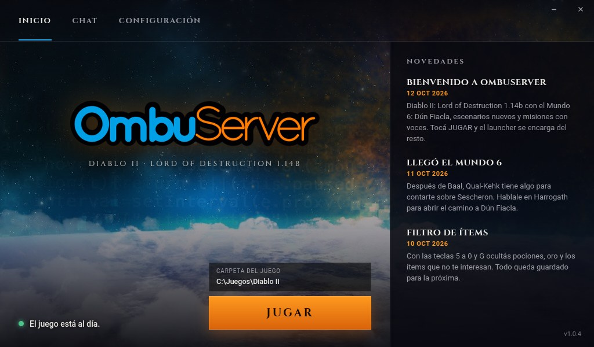
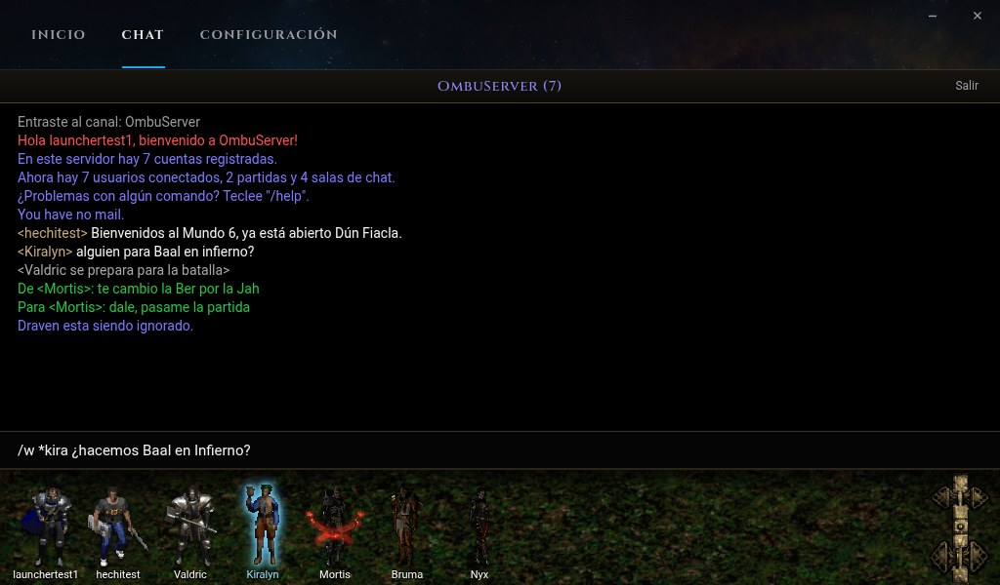
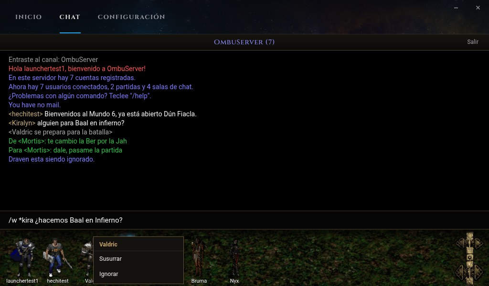
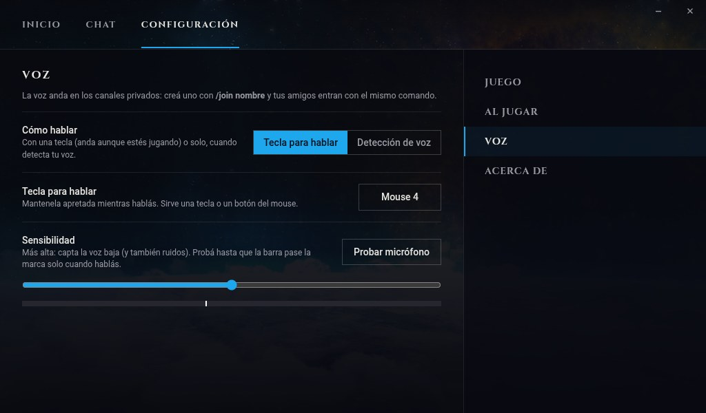
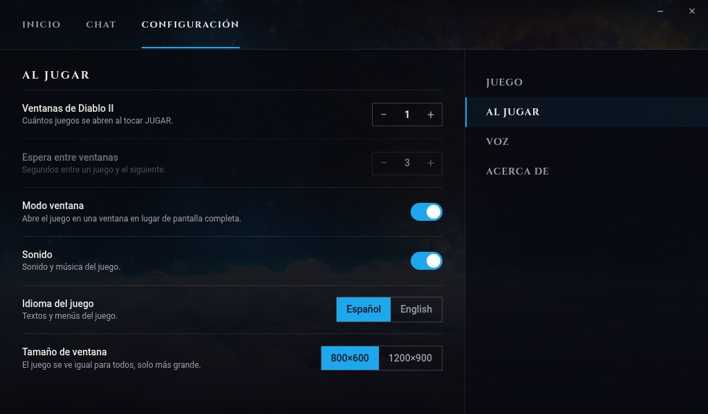
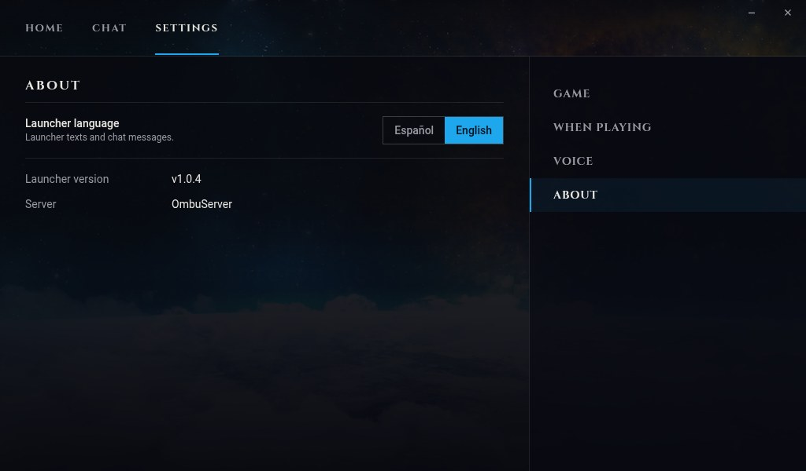

# OmbuServer Launcher

Launcher de **OmbuServer**, servidor de Diablo II: Lord of Destruction 1.14b.

Basado en el launcher de **Slashdiablo** ([nokka/slashdiablo-launcher](https://github.com/nokka/slashdiablo-launcher),
licencia MIT, © 2019 Stefan Konno): se toma su diseño (ventana sin marco, novedades a la derecha, JUGAR abajo,
configuración de ventanas) y su idea de funcionamiento. El código está reescrito: el original usa Qt con
therecipe/qt (sin mantenimiento desde 2020); este usa [Wails](https://wails.io) (Go + WebView2) y está adaptado a
Diablo II 1.14b y a OmbuServer.



## Qué hace

- **Instala el juego** si la carpeta elegida no lo tiene (botón INSTALAR LOD): crea `Diablo II` y baja los archivos,
  verificando cada uno (si se corta, sigue desde donde quedó).
- **Mantiene todo al día** (botón ACTUALIZAR): el cliente de OmbuServer, el contenido del servidor y el propio launcher.
- **Configura Battle.net** en el registro del usuario (sin pedir administrador): agrega el gateway de OmbuServer sin
  borrar los que ya tenga el jugador.
- **Abre el juego** (una o varias ventanas, en modo ventana) directo a Battle.net.
- Muestra las **novedades** del servidor.
- **Chat de Battle.net** sin abrir el juego: los personajes del canal con sus figuras del lobby, susurrar, ignorar
  (con la cruz roja del juego) y las flechas para lo último escrito. Se pausa solo al jugar con la misma cuenta.
- **Voz** en los canales privados ([LiveKit](https://livekit.io)): tecla para hablar que anda aunque el juego tenga el
  foco, o detección de voz; mutear para uno o, el operador del canal, para todos.
- **Español o inglés** (Configuración → Acerca de), y Battle.net contesta en el mismo idioma.

## Capturas

| | |
|---|---|
|  |  |
| **Chat de Battle.net**: los personajes del canal, susurrar y lo último escrito con las flechas. | **Clic derecho sobre un personaje**: susurrar, ignorar (con la cruz roja del juego) y, en la voz, mutear. |
|  |  |
| **Voz** en los canales privados: tecla para hablar o detección de voz, y prueba del micrófono. | **Al jugar**: varias ventanas, modo ventana, 1200×900 nítido e idioma del juego. |
|  | |
| **English**: el launcher también en inglés (Configuración → Acerca de). | |

No pide permisos de administrador. Sus datos van en `%LOCALAPPDATA%\OmbuServer`.

Web: [ombuserver.online](https://ombuserver.online).

**Aviso de Windows la primera vez:** el `.exe` no está firmado, así que al abrirlo por primera vez Windows puede mostrar
"Windows protegió su PC". Tocar **Más información → Ejecutar de todas formas**. Las actualizaciones que baja el propio
launcher no vuelven a mostrar el aviso.

## Compilar

Requiere Go 1.26 y [Wails](https://wails.io) v2.16. Se compila desde Linux o Windows:

```
wails build -platform windows/amd64 -trimpath -ldflags "-s -w"
```

Sale un solo archivo: `build/bin/OmbuServer.exe`.

**Direcciones del servidor:** el código trae valores de ejemplo (`IP-DEL-SERVIDOR-WEB`, `IP-DEL-SERVIDOR-DE-JUEGO`).
Las de tu servidor se ponen al compilar:

```
M=ombuserver-launcher
wails build -platform windows/amd64 -trimpath -ldflags "-s -w \
  -X $M/ombu.URLContenido=http://<servidor web>/contenido/ -X $M/ombu.IPRealm=<ip del servidor de juego> \
  -X main.URLDescargas=http://<servidor web>/descargas/ -X main.urlVoz=https://<servidor web>/"
```

| Carpeta / archivo | Qué es |
|---|---|
| `ombu/` | Núcleo: verificar el juego, bajar y verificar archivos, registro de Windows, abrir el juego |
| `app.go`, `instalar.go`, `actualizar.go` | Lo que usa la ventana: estado, jugar, instalar el juego, actualizar el launcher |
| `chat/`, `chat_app.go` | Cliente de chat de Battle.net (protocolo BNCS) y la sesión del chat |
| `voz.go` | Permiso para la sala de voz (lo da el servidor) y la tecla para hablar |
| `graficos.go`, `ombu/mpq.go` | Las figuras del chat: se leen de `ombuserver.mpq` (lector de MPQ propio) |
| `.github/workflows/compilar.yml` | Compila `OmbuServer.exe` en GitHub Actions |
| `frontend/dist/` | La ventana (HTML, CSS y JavaScript). Abriendo `index.html` en un navegador se ve con datos de ejemplo (`?chat&sesion` para el chat) |
| `frontend/dist/voz.js`, `i18n.js` | La voz del chat y la traducción al inglés |
| `frontend/dist/vendor/` | [livekit-client](https://github.com/livekit/client-sdk-js) 2.22.3 (Apache 2.0), sin cambios |

## Code signing policy / Firma de código

Free code signing provided by [SignPath.io](https://about.signpath.io), certificate by
[SignPath Foundation](https://signpath.org) *(pending approval)*. Releases are built from this repository on GitHub
Actions (`.github/workflows/compilar.yml`) and every release is manually approved before signing.

- Committers and reviewers: [Mariano Genco](https://github.com/MarianoGenco)
- Approvers: [Mariano Genco](https://github.com/MarianoGenco)

Política completa y privacidad / full policy and privacy: <https://ombuserver.online/firma.html>.
This program will not transfer any information to other networked systems unless specifically requested by the user
or the person installing or operating it (it only talks to OmbuServer's own servers: updates, chat and voice).

## Licencia

MIT (ver `LICENSE`). El diseño está basado en [slashdiablo-launcher](https://github.com/nokka/slashdiablo-launcher)
(MIT, © 2019 Stefan Konno). Fuentes Cinzel y Roboto con sus licencias libres (`frontend/dist/fuentes/`).
livekit-client: Apache 2.0, © LiveKit, Inc. Las figuras del chat salen de los archivos de Diablo II y no están en el
repo: viajan adentro de `ombuserver.mpq`, que el launcher baja del servidor.

Diablo II es una marca de Blizzard Entertainment. Este proyecto no está afiliado a Blizzard.
